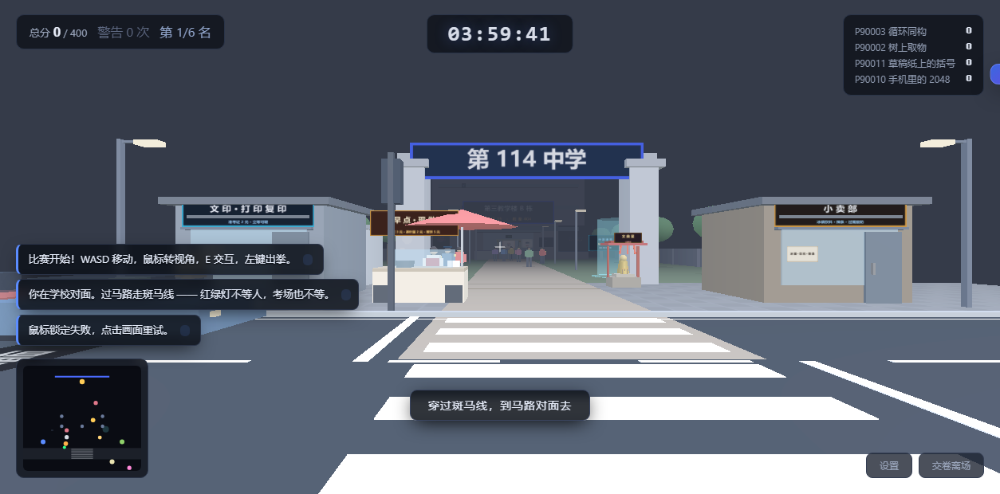

# VR OI 考场 · 网页版

一个能在线玩的第一人称 **NOI / CSP 考场模拟器**：四小时、四道题、四百分；可以写代码、喝水、上厕所，也可以把监考老师放倒，然后被保安追着打。

**在线游玩：** <https://zhiziwj.github.io/vr-oi-simulator-v4/>



## 玩法

- **考前街道**：从学校对面的人行道出发，过一条有红绿灯和车流的街。路边有文印店、早餐摊、小卖部、公交站、文曲星像、网吧，以及卖 rp++ 钥匙扣的老大爷。车流不压线、同道跟车不追尾，临街楼是两排带檐口与店面的楼，不会贴脸也不会是纸板。
- **四小时考场**：进 404 教室，写代码、提交评测、看名次；离开座位会被监考警告，五次直接取消成绩。
- **考后不是立刻结算**：先去 3D 网吧打 dino / 上洛谷刷题，再按分数进入不同 3D 场景——礼堂表彰、光荣榜、班主任办公室、信息教练办公室、补考报名处，或者派出所。
- **隐藏战斗**：打监考 → 两百名保安；校门口打同学 → 志愿者二人组 + 门卫老赵；草稿纸画矩阵 → 老赵的爷爷；考后网吧门口 → **小明**（连第一题都没 AC 的人，嘲讽才开战，血量 120）。
- **战斗间台词**：志愿者、老赵、爷爷和那个人在打斗中会说话——扫堂腿前叫一声「蹲下！」、背刺后说「背后有人。」、被臭水呛到会骂人。
- **多结局**：正常交卷、缺考、取消成绩、公交回家、网吧包夜、校门口传说、医务室、考场毁灭、派出所……共二十多个成就。

## 操作

| 按键 | 作用 |
| --- | --- |
| `WASD` / `Shift` | 移动 / 疾走 |
| 鼠标 | 视角；点击画面锁定鼠标 |
| `E` / 左键 | 场景交互 / 出拳（对准同学、老师或保安） |
| `F` | 干扰同学 / 站上传送圈 |
| `B` | 背包 |
| `Q` | 使用当前消耗品 |
| `P` | 手机（战况 / 群聊 / 2048 / 计算器） |
| `Esc` | 暂停 / 关面板 |
| `空格` | 跳跃（考场内）；小恐龙里是跳跃 |
| `↓` / `S` | 小恐龙蹲下 |

## 手机 / 平板

- 左侧**虚拟摇杆**移动，右侧**拖动屏幕**转视角，不需要鼠标锁定；
- 右下角按钮：攻击/交互、跳、干扰、道具、背包、手机、暂停；
- 3D 弹窗在手机上会自动生成**可点的 DOM 选项**，不要求用准星悬停；
- 小恐龙支持触屏「跳 / 蹲」；
- 桌面预览触控层：`index.html?touch=1`；强制关闭：`?touch=0`。

## 亮点

- **零构建**：纯 HTML + CSS + JavaScript，本地 `three.js`，直接开 `index.html` 就能跑。
- **完整闭环**：街道 → 安检 → 考场 → 交卷 → 考后 3D 场景 → 结算；多结局和存档。
- **真实感细节**：红绿灯车流、监考巡逻、对手成绩曲线、评测机、爆散物理、紧张值后处理。
- **可以打的 boss**：志愿者、老赵（瞬移背刺 + 3 秒红弧扫堂腿）、老赵的爷爷（近身范围冲击 + 10 秒追踪弹 + 吸血）。
- **彩蛋**：早餐五颗心、rp++ 钥匙扣、草稿纸矩阵、dino、洛谷、2048。

## 本地运行

需要 Node.js，或任意静态文件服务器。

```bash
node tools/serve.mjs      # http://127.0.0.1:8848
```

也可以：

```bash
python -m http.server 8848
```

> 不要直接双击 `index.html` 用 `file://` 打开；请通过本地 HTTP 服务器访问。

## 部署到 GitHub Pages

仓库已配置 GitHub Actions 自动部署，推送到 `main` 后会自动发布：

1. 仓库 **Settings → Pages → Build and deployment → Source: GitHub Actions**；
2. 推送 `main`；
3. 等待 `Deploy static site to Pages` 完成，访问 <https://zhiziwj.github.io/vr-oi-simulator-v4/>。

静态站点不需要构建；`.nojekyll` 用来跳过 Jekyll。

## 项目结构

```
index.html            外壳 + 所有面板 DOM
assets/css/main.css   全部样式
js/                   游戏逻辑（按加载顺序排列）
  core / campus / world / player / street / netbar
  postexam / grandpa / brawl / guards / npc / teacher
  items / launcher / luogu / paper / phone / save / ending
vendor/three.min.js   three.js r128（本地）
tools/                冒烟测试 / 浏览器测试 / 静态服务器
docs/DEVELOPMENT.md   详细设计、踩坑记录与完整验证清单
```

## 验证

```bash
node tools/tdzscan.mjs       # 加载期 TDZ / 重复声明扫描
node tools/smoke.mjs         # 无头逻辑冒烟测试，159 项断言
node tools/browsercheck.mjs  # 真实 headless Chrome + WebGL（需先起服务）
```

最近一次验证：`smoke.mjs` 连续 20 次全绿；`browsercheck.mjs` 全绿；`tdzscan.mjs` 干净。

## 说明

- 参考原作：<https://aakaakii.github.io/vr-oi-simulator/>。感谢！
- 小恐龙是对 Chromium 断网小恐龙的 canvas 复刻；three.js 使用 r128。
- 游戏内所有校名、人物、成绩和事件均为虚构，仅供娱乐。

更详细的设计说明、数值来源、历史 bug 和测试覆盖见 [docs/DEVELOPMENT.md](docs/DEVELOPMENT.md)。
